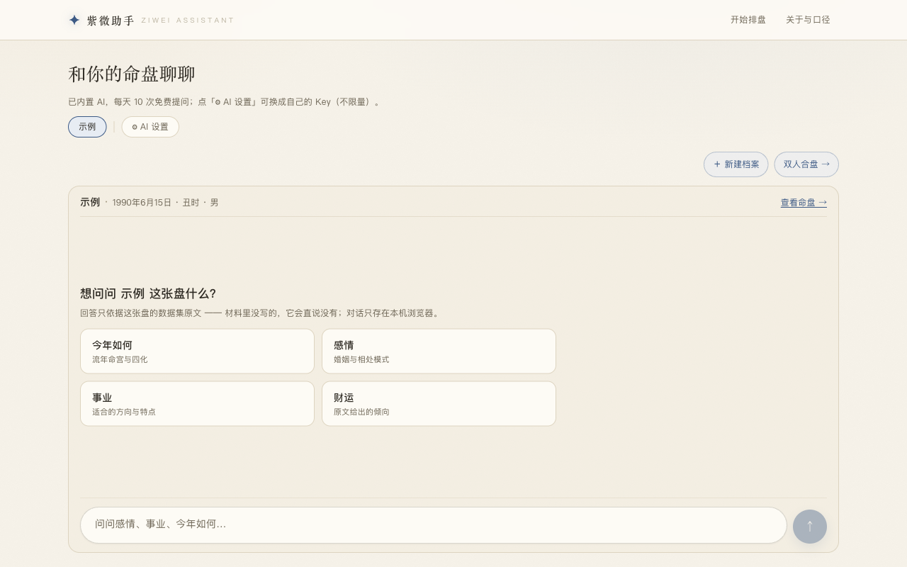
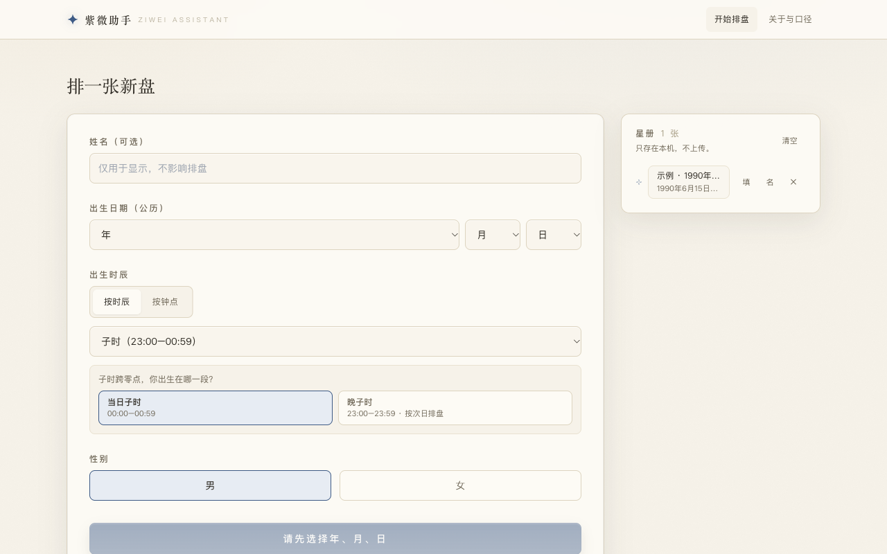
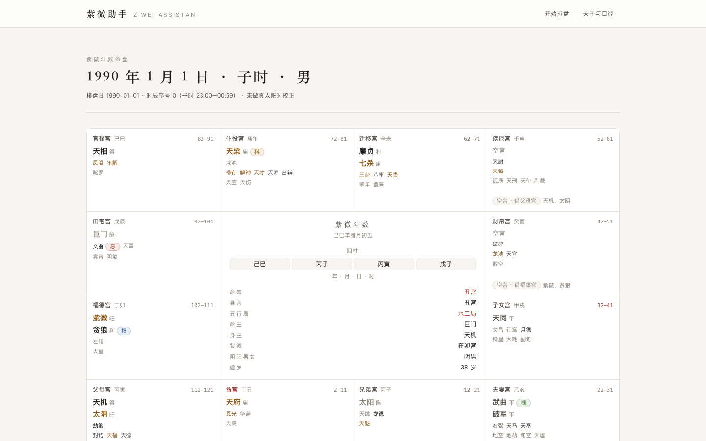
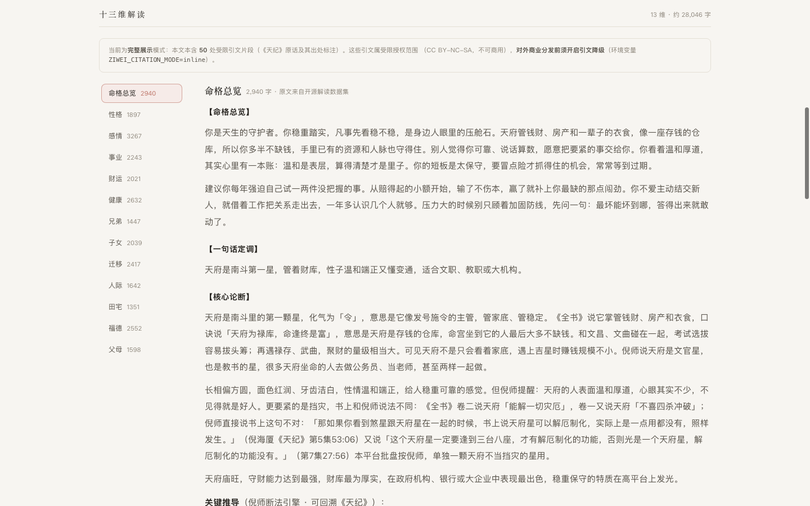

# 紫微BOT（ziwei-assistant）

> 输入生辰 → 确定性排盘 → 12 宫命盘与 13 维解读 → 命盘本地存档、基于命盘的多轮追问。

**在线体验：<https://ziwei.secondplanet.cc>** —— 免费、无需注册；用内置 AI 每天 3 次免费追问，填自己的 Key 则不限量。

[](https://github.com/frankfika/ziwei/actions/workflows/ci.yml)
[](LICENSE)
[](https://github.com/Renhuai123/ziwei-doushu)

**不是「再训一个紫微大模型」项目。** 排盘是确定性计算由程序做，
解读正文来自大规模预生成的数据集按需检索，模型只负责可选的追问环节。

> 本工具仅供文化兴趣与学习之用，不构成任何医疗、法律、投资或人生决策建议。

---

## 界面预览

**首页就是对话：面板头写清在问哪张盘，空态给四张可点的引导卡片，输入框钉在屏幕底部**



**排一张盘：公历生日 + 时辰/钟点 + 性别，星册自动存在本机**



**12 宫命盘**



**13 维解读（正文来自开源数据集检索，非模型生成）**



> 截图用的是公开测试数据（1990-01-01 子时 男）。界面为自研，
> 不含上游商业站的会员/支付/防刷/SEO 功能。

---

## 3 分钟跑起来

**前置**：Node.js ≥ 20.9（Next.js 16 要求）、`zstd`（解压数据用）、磁盘 ≥ 3GB。

```bash
git clone https://github.com/frankfika/ziwei.git && cd ziwei

# ① 装依赖
npm install

# ② 拉解读数据（在上游 release，CC BY 4.0；压缩包单年约 2MB）
#    这里只取 3 年做演示；全部 77 年见下方「全年覆盖」
scripts/download_data.sh --years 1990,2000,2020 --decompress 1990,2000,2020

# ③ 建索引（字节偏移索引，几秒）
npm run index:build -- --years 1990,2000,2020

# ④ 起服务
npm run web:dev        # http://localhost:3000
```

打开 <http://localhost:3000>，点「＋ 新建档案」录入生辰即可出盘。

> **不接任何模型 API 也能完整用**：排盘、12 宫盘面、13 维解读全部是本地计算 + 本地检索，
> 只有「追问」需要模型。数据没覆盖的年份会如实提示，不会编内容补齐。

### 全年覆盖（1950–2026，674,976 张盘）

```bash
for y in $(seq 1950 2026); do scripts/download_data.sh --years $y --decompress $y; done
npm run index:build            # 建全量索引，约 3.5 分钟
npm run data:compact -- --all  # 压成 compact 形态：1.5GB（替代 53GB raw）
# 压完之后 data/raw 可以删掉 —— 查询优先走 compact，缺了才回退 raw
```

---

## 接自己的模型（可选）

只有「追问」需要模型。Web 端读 `apps/web/.env.local`（**该文件已被 gitignore，绝不要提交**）：

```bash
# apps/web/.env.local
ZIWEI_ASK_PROVIDER=openai
ZIWEI_ASK_BASE_URL=https://api.deepseek.com
ZIWEI_ASK_API_KEY=sk-你的key
ZIWEI_ASK_MODEL=deepseek-chat
ZIWEI_ASK_MAX_TOKENS=8000
```

CLI / 脚本则直接用环境变量（同名变量，见 `deploy/.env.example`）。
`ZIWEI_ASK_PROVIDER` 可选 `openai`（OpenAI 兼容：DeepSeek / 智谱 / MiniMax / vLLM / Ollama…）、
`anthropic`、`echo`（不联网本地桩，仅自测用）。

> ⚠️ **别选思维链模型当默认**：带思维链的模型（M3 / R1 / QwQ…）的**思考 token 与正文共用
> 同一份 `max_tokens` 预算**，思考一长就撞上 provider 的 180s 超时，表现为「转圈三分钟后报错」。
> 实测同一提示词：MiniMax-M3 **281s**（思考占 11967/12496 token），
> MiniMax-M1 **12s**（思考仅 397 token）。推荐 `MiniMax-M1` 或 `deepseek-chat`。

不配置也没关系：界面会明确显示「AI 还没配置」，不会静默降级、也不会出网请求。

### 内置追问额度（第一期）

没自配 Key 的访客，内置 AI **每 IP 每天免费 3 次**（按 **UTC 日**切，次日 0 点刷新）。
上限可用环境变量覆盖：

```bash
ZIWEI_ASK_DAILY_LIMIT=3   # 默认 3；设为 -1 表示不限次
```

- 计数口径：请求成功产出回答才扣次；失败/中断不扣。
- 用尽后接口返回 `QUOTA_EXCEEDED`，界面弹出额度墙并给出「流量包」入口（20 / 100 / 500 次三档占位套餐）。
- **支付尚未接通**（stub）：点「购买」只记录意向，不产生真实交易。
- 自带 Key 的用户**不限量**，也不计数。
- 额度相关文案（额度墙 / 用尽提示 / 流量包入口）支持中英切换，语言存本机 localStorage。

---

## 架构

```
[用户生辰：公历日期 + 时辰 + 性别]
              ↓
      @ziwei/chart-engine          确定性排盘（vendored 上游引擎，MIT）
              ↓  ChartJSON
      @ziwei/core                 应用服务层（三端共用入口）
              ↓
      @ziwei/reading-index        偏移索引检索 → 13 维解读原文
              ↓
      ┌──────────┬──────────┬──────────┐
      │ apps/web │ apps/cli │packages/ask│
      │ Next.js  │ 命令行   │ 可选追问  │
      └──────────┴──────────┴──────────┘
```

### 四条硬规则

1. **排盘只走确定性引擎**，禁止 LLM 自己算盘或编星曜。
2. **解读正文只从数据集检索**，不让模型凭空生成整盘断语。
3. **默认不做微调**（无 LoRA / 全参训练 / 继续预训练）。
4. **检索键与数据集严格一致**：`YYYY-MM-DD-时辰序号-性别`，时辰序号 0–11。

> 键口径是**实测确认**的，不是照抄文档 —— **15,400 条样本跨全部 77 个年份
> （1950–2026）100% 直排匹配**，详见 `docs/KEY_SEMANTICS.md`。

---

## 三种用法

### Web

```bash
npm run web:dev      # http://localhost:3000
```

| 路由 | 说明 |
|---|---|
| `/` | **对话首页**：选档案 → 追问；面板头标出当前这张盘；命盘库与对话只存本机 |
| `/new` | **排盘表单**：出生日期 + 时辰/钟点 + 性别 + 本机星册（改名 / 回填 / 删除） |
| `/chart?y=&m=&d=&h=&g=` | 12 宫盘面（手机端为可点选的紧凑四四方阵）+ 13 维解读 + 会话式追问 + 晚子时提示 |
| `/synastry` | 双人合盘（两张盘对照） |
| `/about` | 口径说明、检索键、覆盖情况、署名与免责声明 |

排盘在 **Server Action** 里算（浏览器端不进排盘引擎，避免把 iztro 打进客户端包）。

### 命令行

```bash
npm run chart -- chart --date 1990-01-01 --hour 0 --gender male   # 只看命盘
npm run chart -- read  --date 1990-01-01 --hour 0 --gender male   # 命盘 + 13 维解读
npm run chart -- read  --date 1990-01-01 --hour 0 --gender male --dim love
npm run chart -- coverage                                         # 样本库覆盖情况
npm run chart -- ask   --date 1990-01-01 --hour 0 --gender male --question "今年如何？"
npm run chart -- help                                             # 完整参数表
```

| 子命令 | 说明 |
|---|---|
| `chart` | 排盘并打印 12 宫摘要 |
| `read` | 排盘 + 13 维解读（默认每维 200 字预览，`--full` 打全文） |
| `ask` | 基于命盘追问（需要先配好 provider 环境变量） |
| `coverage` | 样本库覆盖了哪些年份 |

| 开关 | 说明 |
|---|---|
| `--date` | 公历出生日期 `YYYY-MM-DD` |
| `--hour` | 时辰序号 0–11，**或**中文 `子丑寅…` |
| `--clock` | 用钟点代替时辰序号（`--clock 23:30` → 晚子时按次日排盘） |
| `--gender` | `male`/`female`，或 `男`/`女`/`m`/`f` |
| `--name` | 展示用称呼 |
| `--dim` | 只看某一维（`love` 或 `感情`，仅 `read`） |
| `--question` | 要问的问题（仅 `ask`） |
| `--full` | `read` 打印 13 维全文（默认每维 200 字预览） |
| `--json` | 机器可读输出 |

退出码：`0` 成功 / `2` 参数错误 / `3` 样本库未覆盖 / `1` 其他。

### 追问（可选）

追问是**多轮会话**：每张盘的对话存浏览器 localStorage（不上传），
后续问题自动带上前面上文帮助模型理解指代；回答要求大白话，不出现内部标注。

追问的硬约束：只允许使用引擎产出的盘面事实 + 检索到的原文；
材料没写的必须直说「材料里没有写」。回答返回后还会跑一遍**机械自检**
（落宫检查 + 参考星表比对），越界内容会被标出来。

---

## 目录结构

```
ziwei-assistant/
├── packages/
│   ├── chart-engine/      排盘引擎（vendored 上游 MIT）+ chart() 适配器 + ChartJSON 契约
│   ├── reading-index/     数据集偏移索引：构建、查询、键口径、compact 压缩形态
│   ├── core/              应用服务层：ZiweiService（Web/CLI/追问共用）
│   ├── citation-guard/    倪师《天纪》引文检测与降级
│   └── ask/               可选追问：可插拔 LLM provider + 防编造自检
├── apps/
│   ├── web/               Next.js 16 + React 19 界面
│   └── cli/               命令行工具
├── tests/                 回归套件 + 金标准盘快照
├── scripts/
│   └── download_data.sh   数据集下载/解压
├── deploy/                单机 Docker 部署（镜像构建、compose、运维说明）
├── docs/
│   ├── ARCHITECTURE.md    架构契约（实现方必读）
│   ├── KEY_SEMANTICS.md   键口径与排盘语义
│   ├── DATA.md            数据运维手册
│   ├── DEPLOY.md          部署指南（部署者必读）
│   └── LEGAL_NOTES.md     法务要点与引文处理
├── vendor/upstream-reference/   上游 MIT 组件参考（只读）
├── ATTRIBUTION.md         署名与许可（法律义务）
└── data/                  数据集（gitignore，大文件不进 git）
```

---

## 数据

解读数据集 v4.0-13d：674,976 张命盘 × 13 维，1950–2026。

| 目录 | 内容 | 体积 |
|---|---|---|
| `data/zst/` | 77 个压缩包 | 164MB |
| `data/raw/` | 77 份解压后的 JSONL | 53GB |
| `data/compact/` | 77 份压缩形态（推荐） | **1.5GB** |
| `data/index/` | 77 份偏移索引 | **15MB** |

**索引采用「字节偏移」方案** —— 索引总共仅 15MB（源文件 53GB），
查询时直接 seek 到那一行；compact 形态再压 34 倍，部署只需 1.5GB。
详见 `docs/DATA.md`。

---

## 开发

```bash
npm run typecheck     # 全仓类型检查（packages + apps + tests）
npm test              # 回归套件（56 用例，含金标准盘与键口径实证）
npm run acceptance    # MVP 总验收（24 项，typecheck + test + CLI 端到端 + web build）
npm run index:build   # 建索引
npm run data:compact  # 压 compact 形态
npm run chart -- chart --date 1990-01-01 --hour 0 --gender male   # CLI
npm run web:dev       # Web 开发服务器
npm run web:build     # Web 生产构建
npm run ask:selftest  # 追问模块自测（零网络）
npm run citation:selftest  # 引文降级自测（25 用例，含真实数据回归）
```

单机 Docker 部署见 [`docs/DEPLOY.md`](docs/DEPLOY.md)：

```bash
npm run docker:build  # 构建镜像（数据集不进镜像，走卷挂载）
npm run docker:up     # 起服务
npm run docker:logs   # 看日志
npm run docker:down   # 停服务
```

回归套件包含**金标准盘快照**（9 份，覆盖闰日/闰月/年末/时辰边界/男女/数据集首尾年）：
引擎变更若静默改盘，测试会指出**具体哪个 JSON 路径**变了。

```bash
npm test
# ✗ 金标准盘被改动了：2000-02-29-h06-male（闰年 2 月 29 日 · 午时 · 男）
#   共 3 处差异：
#     · $.mingGongFirstMajorStar   快照: "紫微"   重算: "天同"
#     · $.wuxingJuName             快照: "木三局"  重算: "水二局"
```

刷新快照（确认变更是**有意**的之后）：

```bash
ZIWEI_UPDATE_GOLDEN=1 npm test
```

然后 review `git diff` 再提交。

CI：`.github/workflows/ci.yml`（push / PR → 装依赖 → typecheck → test）。
CI 没有 56GB 数据集，数据相关用例**自动跳过并说明原因**，纯引擎用例照跑。

---

## 排障

| 症状 | 多半是 | 怎么办 |
|---|---|---|
| 界面提示「样本库未覆盖」 | 该年份没建索引 | `npm run index:build`（或补该年数据） |
| `npm run web:dev` 起不来 / 端口占用 | 3000 被占 | `PORT=3001 npm run web:dev` |
| 追问面板显示「AI 还没配置」 | 没配 provider | 配 `apps/web/.env.local`（见上文「接自己的模型」） |
| 追问转圈很久后报 timeout | 选了思维链模型，思考 token 吃满预算 | 换 `MiniMax-M1` / `deepseek-chat` 这类快模型 |
| 解压数据失败 | zstd 长窗口 | 必须 `zstd -d --long=27`（脚本已带） |
| 磁盘不够 | 解压全年代要 53GB | 用 `npm run data:compact -- --all` 压成 1.5GB 后删掉 `data/raw` |

---

## 已知边界

| 项 | 状态 |
|---|---|
| 数据覆盖 | **已全年代 1950–2026**（674,976 条全部可查）；重铺见 `docs/DATA.md` 第 4.3 节 |
| 真太阳时 / 夏令时 | **不做**（数据集未做，做了检索键会错位）。后续独立需求 |
| 倪师《天纪》引文 | 数据集里密度很高（79% 的维度文本含受限引文片段）。已提供检测与降级工具，商业化前须处理，见 `docs/LEGAL_NOTES.md` |
| 闰月 / 亮度流派 | 引擎内部固定为 `split`（月中分界）+ 全书派亮度表，与数据集生成口径一致 |
| 闰月标记 | `isLeapMonth` 在 `split` 下**恒为 false**，闰月体现为农历月归属，别拿它判断闰月 |
| 盘面缓存 | `currentAge` 随当天日期变 → 整个 `ChartJSON` **不可缓存** |
| 盘外星曜检测 | 引擎每张盘都落全部 70 颗星（只落宫不同），所以集合判定几乎不触发；防编造靠**落宫检查** + 参考星表 |
| 追问模块 | 默认不接任何真实 API（需自行配置 provider 环境变量）；内置 AI 每 IP 每天 3 次（`ZIWEI_ASK_DAILY_LIMIT` 可覆盖），用尽后可买「流量包」 |
| 追问输出方式 | **流式**：模型吐字就实时显示（SSE），思维链内容不外露 |
| 本地存档 | 命盘库与追问对话只存浏览器 localStorage，不上传；命盘最多 50 张、每盘对话最多 20 条 |
| 上游商业站功能 | **不**实现会员/支付/防刷/SEO 站群；界面为自研 |

---

## 署名与许可

**必须保留**以下来源标注（详见 `ATTRIBUTION.md`）：

```
本项目使用了「紫微斗数开源解读数据集 v4.0」（674,976 张命盘 × 13 维）
以及开源排盘引擎。
来源：https://github.com/Renhuai123/ziwei-doushu
作者：王多鱼AI
数据集许可：CC BY 4.0；引擎代码：MIT。
```

```
本工具仅供文化兴趣与学习之用，不构成任何医疗、法律、投资或人生决策建议。
```

上游仓库：https://github.com/Renhuai123/ziwei-doushu
